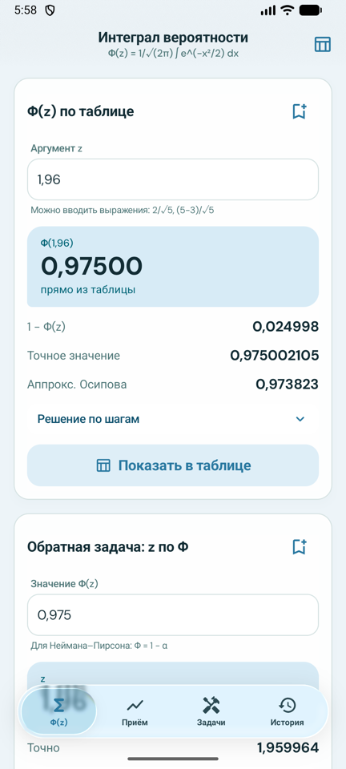
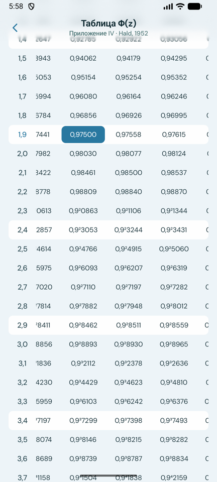
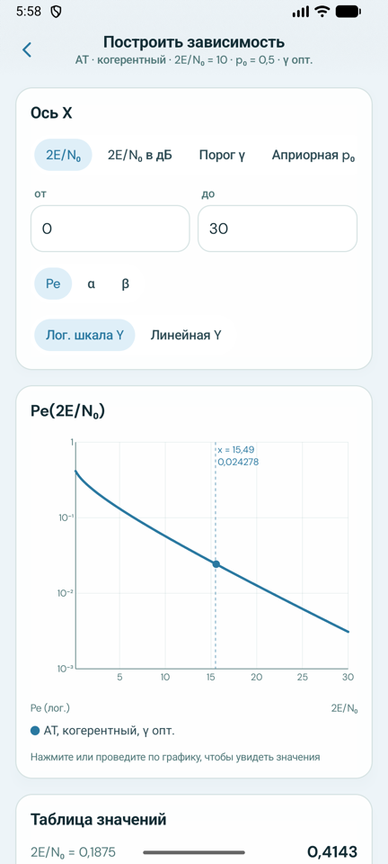
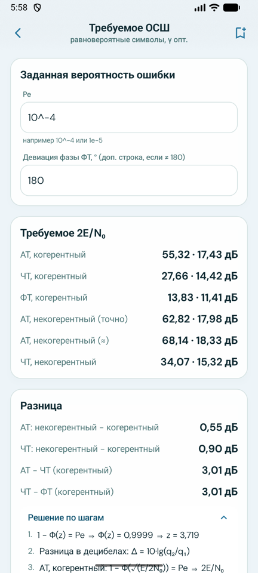

# PhiLab

Android-калькулятор для курса **«Оптимальные алгоритмы приёма сигналов в радиосвязи»**:
таблица интеграла вероятности Φ(z), вероятности ошибок приёма АТ / ЧТ / ФТ, графики, ОФТ и другие
задачи практических занятий — с решением по шагам, которое можно переписать в тетрадь.

## ⬇️ Скачать

**[Последняя версия APK → Releases](../../releases/latest)**

1. Откройте ссылку с телефона и скачайте файл `PhiLab-vX.Y.Z.apk`.
2. Откройте его. Android попросит разрешить установку из этого источника (браузера / файлового менеджера) — разрешите.
3. Нужен Android 10 или новее.

Обновления ставятся поверх старой версии, история расчётов сохраняется.

## Возможности

| | |
|---|---|
| **Φ(z) по таблице** | Таблица Hald (Приложение IV), z = 0…4,99: прямо из ячейки, интерполяция, симметрия Φ(−z) = 1 − Φ(z), z ≥ 5 — аналитически. Запись как в книге: 0,9³8215. Обратная задача z по Φ, аппроксимация Осипова. |
| **Нормальная СВ** | P(X > a), P(X < a), P(a < X < b) для N(m, D). |
| **Приём двоичных сигналов** | Когерентный: АТ, ЧТ (в т.ч. ρ = sin ΔT/ΔT), ФТ с любой девиацией фазы, произвольная пара сигналов. Пороги: оптимальный (идеальный наблюдатель), заданный, c·E/N₀, Нейман–Пирсон. Выводятся m₀, m₁, σ, α, β, Pe и проигрыш к ФТ. Некогерентный: АТ точно (функция Маркума), ЧТ. |
| **Графики** | Pe, α, β от 2E/N₀ (раз / дБ), порога γ, p₀, Δφ, ΔT; лог. шкала, сравнение с оптимальным порогом, таблица значений. |
| **Требуемое ОСШ** | 2E/N₀ для заданной Pe и разница в дБ между методами приёма. |
| **Команды и синхрослова** | Не более k ошибок из N, число повторов, срабатывание по шумам. |
| **ОФТ** | Кодирование символов в фазы и декодирование обратно. |
| **СФ и коррелятор** | Потери при рассогласовании по длительности и по фазе. |
| **Шпаргалка и история** | Формулы курса; сохранённые расчёты. |

Во всех полях можно вводить выражения: `1/4`, `10^-3`, `2/√5`, `ln(3/7)`, `π/3`.

<p>
  
  
  
  
</p>

## Сборка из исходников

Нужен JDK 17+ (подойдёт JBR из Android Studio) и Android SDK.

```bash
./gradlew :common:testDebugUnitTest :app:assembleDebug
```

APK: `app/build/outputs/apk/debug/app-debug.apk`.

Таблица Φ(z) лежит в `common/src/main/assets/phi_table.json`. Она сгенерирована скриптом
[`tools/phi_table.py`](tools/phi_table.py) и сверена со сканом печатной таблицы. Ответы задач практики
покрыты unit-тестами (`common/src/test`).

## Архитектура

- `common` — domain (математика и use case'ы), data (Room, таблица Φ), presentation (Compose).
- `app` — Application, MainActivity, DI-граф, корневая навигация.
- Стек: Jetpack Compose, Decompose, MVIKotlin, Dagger (KSP), Room, kotlinx.serialization.
- Liquid Glass (панель вкладок, уведомления) — [Kyant0/AndroidLiquidGlass](https://github.com/Kyant0/AndroidLiquidGlass):
  рефракция работает на Android 13+, размытие — на 12+, на более старых версиях вместо стекла плотная заливка.
  Размытие под верхней панелью — [Haze](https://github.com/chrisbanes/haze).

## Выпуск новой версии (для мейнтейнера)

Релизы собирает GitHub Actions ([`release.yml`](.github/workflows/release.yml)) при пуше тега `v*`:

```bash
git tag v1.0.0
git push origin v1.0.0
```

Один раз нужно добавить секреты в **Settings → Secrets and variables → Actions**:
`KEYSTORE_BASE64`, `KEYSTORE_PASSWORD`, `KEY_ALIAS`, `KEY_PASSWORD`.
Ключ подписи и пароли в репозиторий не коммитятся (`keystore.properties`, `*.jks` в `.gitignore`).

## Благодарности

- Таблица Φ(z): A. Hald, *Statistical Tables and Formulas*, John Wiley, 1952.
- Шрифт [DM Sans](https://fonts.google.com/specimen/DM+Sans) — SIL Open Font License 1.1.
- Liquid Glass: [backdrop](https://github.com/Kyant0/AndroidLiquidGlass) — Apache License 2.0.
